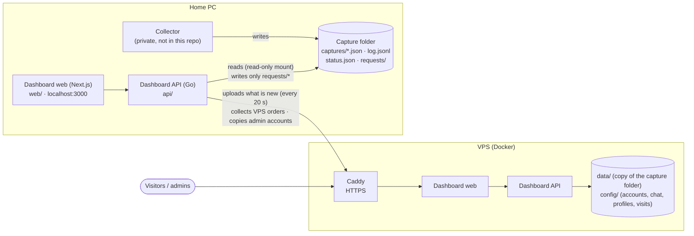

# NMIXX FANS tracker — dashboard

A dashboard that shows when NMIXX members like or comment on fan posts in the NMIXX fan community on
[FANS](https://app.fans), and how busy the fan feed is hour by hour. It runs live at **[axismixx.com](https://axismixx.com)**.

FANS shows *that* a member liked a post, but never *when*. A separate collector saves a reading of the fan feed about
every 30 minutes. This dashboard compares the readings and works out roughly when each like happened, from what changed
between two readings.

This repository holds the **Go API** and the **Next.js web app**, with a fake-data demo. The collector that reads FANS
is kept private. The dashboard never contacts FANS: it only reads the files the collector writes.

- Every dashboard feature in detail (accounts, chat, profiles, visitor counter, sign-up, deploy): [`DASHBOARD.md`](DASHBOARD.md)
- Words used throughout (artist like, uncertainty window, pass…): [`GLOSSARY.md`](GLOSSARY.md)

---

## Try it with fake data

You don't need the collector, FANS or a server. `api/testdata/make-demo.mjs` invents two days of collector output,
and `docker-compose.demo.yml` points the API at it.

```sh
cp .env.example .env              # fill in API_TOKEN and SESSION_SECRET (any long random strings); nothing else is needed
node api/testdata/make-demo.mjs   # writes api/testdata/demo/ (git-ignored)
docker compose -f docker-compose.yml -f docker-compose.demo.yml -p fans-demo up -d --build
docker compose -f docker-compose.yml -f docker-compose.demo.yml -p fans-demo run --rm -it api user add demo admin
# open http://localhost:3001 and log in as "demo" to see the admin pages too
```

You need Node.js 18 or newer and Docker Compose 2.24 or newer. The demo runs on port 3001, keeps the API port
closed, never uploads anywhere (even if `.env` says to) and keeps its own accounts in `api/testdata/demo/config/`.
Running `make-demo.mjs` again makes new data and deletes the demo accounts. To stop the demo, run the same
`docker compose … -p fans-demo` command with `down` in place of `up -d --build`.

**What the fake data contains.** Each file has the same shape as the collector's real output, so the API reads it
exactly as it reads real captures. Every post, name and comment is invented and marked `DEMO`.

| Piece | How it is made |
| --- | --- |
| Captures | 48 hours ending when you run the script, one reading every 8–15 min. Each file holds the 10 newest posts. |
| Fan posts | 0–3 new posts per reading, by authors named `demo_fan_<n>`. |
| Artist likes | Six members, each at their own rate. Likes are most likely in the Korean evening (19:00–01:00 KST), less likely in the afternoon, and rare at other times. |
| Artist comments | Now and then, with an exact time, the way FANS reports comments. |
| An outage | Three hours with no readings, about 30 hours back, while likes pile up. This shows wide uncertainty windows and "no data" hours. |
| `log.jsonl` | One line per reading, for the Admin page's health view: request counts, token and cookie expiry times, and a skipped reading. |

The random numbers come from a fixed seed, so every run makes the same pattern, ending at the current time. Real likes
mostly land on posts the moment they appear. The demo adds likes to posts that are already visible, so most of its
likes show as late likes.

---

## Architecture



| Part | What it does |
| --- | --- |
| **API** (`api/`) | Go: the standard library, plus `x/crypto` for argon2 and `x/term`. Reads the captures, works out artist like and comment events, serves JSON. Also accounts, chat, profiles and the visitor counter. One package, with a test file for almost every feature. |
| **Web** (`web/`) | Next.js 16 (App Router, server components). The pages people see, login sessions, and the only thing allowed to call the API (with a shared secret). |
| **Caddy** (`Caddyfile`) | HTTPS in front of the web app on the VPS; gets its own certificate. |

The same API and web app run in two places:
- **On the home PC**, next to the collector, as the private control room.
- **On a VPS**, as the public site, which keeps working when the PC is off.

The PC keeps the VPS up to date, and the VPS never needs to reach into the home network.

---

## How it works

### Captures in, events out

The collector saves each reading as `captures/<time>-<kind>.json`, in the shape FANS returns, plus a `coverage` list
of the time spans the reading saw completely. The API (`api/store.go`) reads every capture in order, every 30 s, and
compares each post with the previous reading of it:

- **Artist like.** FANS lists which members liked a post, never when. A like is *detected* at the first reading that
  shows it. Its **uncertainty window** runs from the last reading of that post without the like to the reading with it.
  - Charts place a like at its **post's time**, because members mostly like fresh posts as fans post them during a visit.
  - A like that was already there when the post was first seen is an **instant like**. One that appears later is a
    **late like**: the member came back to an older post. Its card shows the window it really happened in.
- **Artist comment.** FANS gives the exact time, so it's recorded once per comment.
- **Fan posts by hour.** Each hour knows how much of it some reading actually saw. Hours nobody saw show as "no data",
  not 0, and averages use only hours seen at least 80%.

The events are held in memory and rebuilt from the captures at start-up; the capture files are the source of truth.
Members are matched by their artist code, because their display nicknames change.

### Controlling the collector without touching it

The dashboard never starts programs or contacts FANS. The Admin page leaves small **request files** in the collector's
folder, and reads the **status files** the collector writes back:

| Request file | Admin page | Meaning |
| --- | --- | --- |
| `requests/START` | **Start** | a launcher on the PC starts the collector |
| `requests/PULL` | **Pull now** | the next reading happens early (still inside the request budget) |
| `requests/control.json` | Loop and settings | `{ paused, saveImages, showWindow }` |
| `requests/RESUME` | **Resume** | must hold the exact text of the halt reason, so an old click can't clear a newer halt |
| `requests/LOGIN` | **Log in to FANS** | the collector opens FANS on screen for a login |
| `requests/RESTART`, `requests/QUIT` | **Restart**, **Stop** | the collector closes between readings; after Restart the launcher starts it again with its current code |
| `requests/TRANSAM` | **Trans-Am** | fast mode for when a member is online: a reading about every 30 s for 5 min, inside the request budget |

The collector writes `status.json` (alive, waiting or reading, why it last stopped, Trans-Am progress) and
`launcher.json` (the supervisor that restarts it after a crash). The API passes these to the Admin page, which polls
every 5 s.

### PC → VPS sync and remote control

The PC's API already reads the capture folder, so it also uploads it to the VPS (`api/push.go` on the PC,
`api/sync.go` on the VPS). The uploads go through the VPS web app's `/api/sync/*` route, which accepts only a shared
`SYNC_TOKEN`.

- **What:** captures (oldest first), saved images, new lines of `log.jsonl`, and the halt flag. Everything is gzipped
  and written atomically, in the same layout as on the PC.
- **When:** every 20 s the PC compares a small summary of the folder with the last round, and sends nothing if nothing
  changed. It also checks every 10 min in case the VPS was reset. After a failure it backs off, up to 10 min.
- **Accounts** go the other way: the PC copies the admin accounts (names, roles, password hashes) from the VPS every
  5 min, so admins use the same password on both.
- **Remote control** (`api/remote.go`, `api/push_remote.go`): the VPS Admin page's buttons become orders. The PC keeps
  a long-poll request open to the VPS, so orders arrive within a second or two with no open ports at home. The PC
  carries each one out by writing the same request files as its own Admin page, and reports back how it went.

### Accounts, chat, profiles, visitors

- **Accounts:** roles `admin` and `user`. Passwords are stored only as argon2id hashes. The web app keeps a 7-day
  session cookie signed with `SESSION_SECRET`. Five wrong passwords lock an account for 15 minutes. Anyone can sign up
  as a `user` by email (Brevo, optional Cloudflare Turnstile); admins are made only with the `api user` command.
- **Chat and feedback** on the main dashboard, for signed-in users.
- **Profiles:** the picture is re-drawn on the server as a clean 256×256 JPEG, so no GPS or camera data survives.
- **Visitor counter:** visitors and page views per day, unique visitors over 7 and 30 days, top pages, referring
  sites. **No IP address is stored.** A visitor is a daily-salted hash of IP and user agent, thrown away at midnight.
  Unique counts come from the browser saying how many days ago its last visit was, and the server keeps only a
  per-day tally of those answers.

---

## Pages

| Page | Who | Shows |
| --- | --- | --- |
| `/` Main dashboard | everyone | members' likes and comments, active hours, activity timeline, weekday × hour heatmap, fan posts by hour (with minute zoom), chat |
| `/feed` Fan feed | admin | every fan post seen, live, with search, fan-burst folding and an "artist activity" view |
| `/admin` | admin | collector controls and health (request budget, last reading, log), PC → VPS upload status, visitor counter, feedback |
| `/profile` | any account | picture, display name, password |
| `/login` `/signup` `/confirm` `/forgot` `/reset` | everyone | accounts |

Times can be shown in Bangkok, Seoul, Japan, China or UTC time.

---

## Repository layout

```
api/                            Go API (one package)
  main.go                       routes, settings, start-up
  store.go                      reads captures, works out like/comment events, stats
  feed.go fanminutes.go fandays.go   fan feed, minute-by-minute and per-day fan posts
  health.go admin.go pull.go    request budget and token health; collector controls; Pull now
  push.go push_remote.go        PC side of the VPS upload and remote control
  sync.go remote.go             VPS side of the upload and remote control
  auth.go account.go usercmd.go accounts, sign-up/reset by email, the `api user` command
  chat.go profile.go visits.go  chat and feedback, profiles, visitor counter
  testdata/make-demo.mjs        invents fake collector output for the demo
web/                            Next.js app
  app/                          pages and route handlers (app/api/* forwards to the Go API)
  components/                   charts, feed, chat, admin panels
  lib/                          API types, sessions, auth checks, time zones
  proxy.ts                      turns people away from pages their role can't see
deploy/vps-setup.sh             sets up or updates a VPS (Docker, secrets, Caddy)
docker-compose.yml              home PC: api + web on localhost
docker-compose.vps.yml          VPS: api + web + Caddy
docker-compose.demo.yml         demo: fake data, port 3001, no upload
```

---

## Running it for real

**Home PC** (next to a capture folder):

```sh
cp .env.example .env         # set FANS_DATA_DIR, API_TOKEN and SESSION_SECRET (long random strings)
docker compose -p nmixx-fans up -d --build
docker compose -p nmixx-fans run --rm -it api user add <name> admin
# http://localhost:3000 (ports bind to 127.0.0.1 only)
```

**VPS** (Ubuntu), from an unpacked copy of this folder:

```sh
sudo bash deploy/vps-setup.sh <domain>
sudo docker compose -f docker-compose.vps.yml -p nmixx-stats run --rm -it api user add <name> admin
```

The setup script installs Docker, creates the secrets and prints the `SYNC_TOKEN` for the PC. Then add `VPS_URL` and
`VPS_SYNC_TOKEN` to the PC's `.env`, plus `VPS_REMOTE_CONTROL=1` to let the VPS Admin page send orders. Running the
script again after an update keeps `.env`, the accounts and the data, and rebuilds the containers.
[`.env.example`](.env.example) lists every setting.

## Tests

```sh
docker run --rm -v "$PWD/api:/src" -w /src golang:1.25-alpine go test ./...   # Go API
cd web && npx tsc --noEmit                                                     # web types
```

## Limits

- A like's time is its post's time, an estimate. It's right for likes on fresh posts and early for late likes (their
  card shows the real window: about 30 min, or about 10 while a member is active).
- Only posts the collector's readings reach are tracked. FANS shows only a member's latest comment per post, so an
  earlier comment replaced between two readings is missed.
- While the PC is off nothing is captured. The VPS keeps showing everything up to the last upload, and charts show the
  gap as "no data".

---

*A fan project, not affiliated with FANS, JYP Entertainment or NMIXX.*
